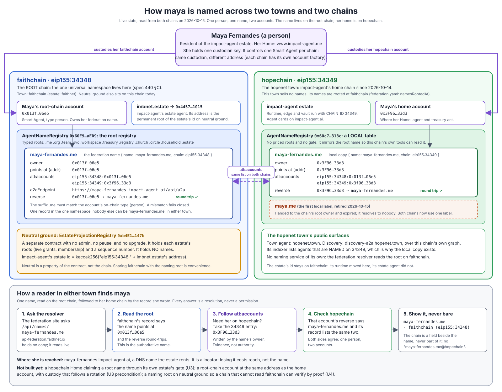

# Naming primer — two towns, two chains, one name

**Status:** 2026-10-15. Every value below was read from both chains that day. This page decides nothing: the
decision of record is [spec 440 §C](../../specs/440-shared-kms-federation-site-and-universal-naming.md), the detail is
[`naming-service.md`](naming-service.md), and the reasoning is [`federated-agent-naming.md`](federated-agent-naming.md).

## What we are trying to do

Give every agent in the federation **one name that means the same thing in every town**. A person named
`maya-fernandes.me` should be Maya whichever town is reading. Nobody else should be able to take that name in another
town, and the name should keep working when her home moves to a different chain.

We do it the way ENS does it on Ethereum. **Names live on one chain, the root chain**, which is faithchain today. Other
chains don't run their own naming registry. They point back at the root.

## The picture

## Who is in it

| | Chain | What it does for names |
| --- | --- | --- |
| **faithchain town** | faithchain, `eip155:34348` | The **root chain**. Its `AgentNameRegistry` holds the federation's names under the typed roots (`.me`, `.org`, `.svc`, …). It is also where neutral ground sits today. Home of the faithnet estate (alice). |
| **hopenet town** | hopechain, `eip155:34349` | The second town, live since 2026-10-14. Home of the impact-agent estate (maya). It **sells no names**. It keeps a local copy of its residents' names so its own discovery index can list them. |
| **neutral ground** | faithchain | `EstateProjectionRegistry`. It holds each estate's roots, which prove standing. **It holds no names.** It shares a chain with the naming root, but it is a separate contract. |
| **the federation resolver** | none | https://ap-federation.faithnet.io/api/names. It reads the towns live and shows every name with its chain. |

## The rules, in plain words

1. **The account is the identity, and the name points at it.** Maya is an account, `eip155:<chain>:<address>`. The name
   is a label on that account, so losing a credential never changes who she is.
2. **One name, one record, on the root chain.** `maya-fernandes.me` exists once in the namespace. A town can keep a
   copy, but it never issues the same name to someone else.
3. **The ending says what kind of agent it is.** `.me` is a person, `.org` an organization, `.svc` a service. The chain
   checks this, and a mismatch is refused.
4. **The chain sits beside the name, never inside it.** It's written `{ name: maya-fernandes.me, chain: eip155:34348 }`
   and shown as `maya-fernandes.me · faithchain`. Never write `maya-fernandes.me@hopechain`: `@` means "issued by an
   org, team or workspace".
5. **A name is never a permission.** Knowing who someone is says nothing about what they may do in your town.

## Maya, chain by chain

Maya holds **one custodian key**. It controls **one Smart Agent on each chain**. The addresses differ because each
chain has its own account factory.

| | faithchain (root) | hopechain (her home chain) |
| --- | --- | --- |
| Her account | `0x013f…06e5` | `0x3F96…33d3` |
| Registry | `AgentNameRegistry 0x60E9…aED9`, the root | `AgentNameRegistry 0x60c7…318c`, a local table with no priced roots and no gate |
| `maya-fernandes.me` points at | `0x013f…06e5` | `0x3F96…33d3` |
| Reverse lookup | `0x013f…06e5` → `maya-fernandes.me`, round trip ✓ | `0x3F96…33d3` → `maya-fernandes.me`, round trip ✓ |
| `atl:accounts` | `eip155:34348:0x013f…06e5`, `eip155:34349:0x3f96…33d3` | the same two entries |
| Where she is reached | `https://maya-fernandes.impact-agent.ai/api/a2a` | (same agent card host) |
| Retired | — | `maya.me`, the first local label: expired on 2026-10-15 and resolves to nobody |

**`atl:accounts` is the bridge.** It is a record that the name's owner writes on each chain, listing her account on
every chain. It is how a reader holding the root name finds her on hopechain, and how a reader on hopechain finds her
root name. It is evidence written by her own accounts. It is not a permission, and no operator wrote it for her.

## How a reader finds her

1. **Ask the resolver.** `GET /api/names/maya-fernandes.me` on the federation site.
2. **Read the root.** faithchain says the name points at `0x013f…06e5`, and the reverse lookup agrees.
3. **Follow `atl:accounts`.** To reach her on hopechain, take the `eip155:34349` entry: `0x3F96…33d3`.
4. **Check hopechain.** That account's reverse lookup says `maya-fernandes.me`, and its record lists the same two
   accounts. Both chains agree, so this is one person with two accounts.
5. **Show it with its chain.** `maya-fernandes.me · faithchain (eip155:34348)`.

Today the federation resolver does steps 1, 2 and 5. Steps 3 and 4 work on chain but are not in the resolver yet,
because no town's naming read API exposes `atl:accounts`.

## What is live, and what is not

| | Status |
| --- | --- |
| One namespace on faithchain; the resolver; names always shown with their chain | **live** (U1) |
| `{ name, chain }` in the naming package; `atl:accounts` on **both** chains for the impact-agent roster | **live** (U2; records written 2026-10-15) |
| The resolver reading `atl:accounts` and checking the round trip on the second chain | **not built**. The records exist; nothing in the resolver reads them yet |
| A hopechain resident claiming a root name through **their own estate's gate**, from their Home | **designed** (U3). hopechain has no gate named on the root, and maya's root account is a separate account rather than one at her home address |
| Custody that follows a credential rotation from her home account to her root-chain account | **designed** (U3 precondition, a Ring 0 spec) |
| A chain that cannot read faithchain verifying a name by proof against neutral ground | **proposed** (U4) |
| The root's governor becoming a council of town clerks | **open** (U5) |

## Where to read next

| Question | Document |
| --- | --- |
| The full service: layers, issuance, how another chain joins, the waves | [`naming-service.md`](naming-service.md) |
| Why one root, and what the field does instead | [`federated-agent-naming.md`](federated-agent-naming.md), spec 440 §C |
| ERC-8004, ENS v2, ANS, AID, HCS-14, NANDA | [`naming-landscape-crosswalk.md`](naming-landscape-crosswalk.md) |
| How standing (not names) crosses between towns | [`cross-chain-authority.md`](cross-chain-authority.md) |

---

## How this compares with ENS v2

**Where ENS v2 stands (sources in [`naming-landscape-crosswalk.md`](naming-landscape-crosswalk.md) §4).** Its own
rollup, Namechain, was cancelled in 2026-02, so v2 runs on Ethereum L1 only. The activation proposal was submitted
2026-10-13 and the vote is pending.

**In one sentence.** We took ENS v2's shape: one root chain, a registry per name, other chains resolving back to the
root, and a reverse record that counts only when the forward record agrees. We changed what sits in each slot. Here
the owner is a Smart Agent rather than a token holder, the ending is a type the chain checks, and a claim needs a
ticket from the owner's own estate. A name is also kept strictly apart from permission.

### Capabilities

| Capability | ENS v2 | This federation | Status here |
| --- | --- | --- | --- |
| One global namespace | one root, `name.eth`, on Ethereum L1 | one root, typed roots (`.me .org .svc …`), on faithchain | live |
| What the name says about its subject | nothing; any name can point at anything | the ending is the agent's type (`.me` = person), checked on chain, and a mismatch fails closed | live |
| Who can register | anyone who pays | a holder whose own estate's naming gate signs a claim ticket; the domain rule (a protected label) is checked at the Home | live on the root; not yet for a hopechain estate (U3) |
| Owner | an address holding the name's token (NFT) | a Smart Agent; the name is a label on the account (ADR-0010) | live |
| Losing a key | the name goes with the key unless it sits in a separately managed wallet | credential recovery and rotation are custody ceremonies; the account, and so the name, never moves | live |
| Price and term | annual rent, expiry with grace, a decaying premium on re-release | a one-time price in a test coin; no expiry, no transfer, one name per owner per root (ap-town spec 431 D6) | live; rent with expiry is a planning proposal, not yet a spec |
| Transfer and resale | yes; a name is a token | no; deliberate, so a label is never the evidence that someone is the same person | live |
| Subnames | the owner's own registry, with roles | an owner hands child issuing to a contract; context names `x.t@ctx` are issued by an org, team or workspace and recorded in its vault first | live (registry hook); owner-run paid subname registrars are proposed |
| Addresses per chain | `addr(node, coinType)` (ENSIP-9/11) | `atl:accounts`: one account id per chain, written by the owner on each chain | live on both chains for the impact-agent roster |
| Primary name per chain | ENSIP-19: valid only with the forward | the same rule; maya's reverse round-trips on both chains | records live; the resolver does not enforce it per chain yet |
| Resolving from another chain | CCIP-Read (ERC-3668) through gateways; Universal Resolver | direct read of the root where it is readable (today: one operator); by proof against a naming root on neutral ground where it is not | direct read live; proof is proposed (U4) |
| Showing a name off its home | the name alone; ERC-7828 `name@chain` proposed | never bare: `{ name, chain }`, shown as `maya-fernandes.me · faithchain`; `@` is reserved for context | live |
| DNS names | DNSSEC import into ENS | a DNS host is a rented locator the agent publishes, never the identity | live (agent card hosts) |
| Governance of the root | the ENS DAO | one governor key (`naming.svc`, the town clerk); a council of town clerks is named, not designed | open (U5) |
| Trust signals | out of scope | named · typed · listed · reachable, plus issued-by, projected, presented, each shown separately and never added up | live on the site |
| Authority | out of scope | a name grants nothing; standing and permission are separate mechanisms | live, by design |

### Architecture

| Layer | ENS v2 | This federation |
| --- | --- | --- |
| Root | Registry contracts on L1, governed by the DAO | `AgentNameRegistry` on faithchain, with a priced subregistry per typed root |
| Hierarchy | "every name has its own registry"; roles replace fuses | multi-root registry; per-root priced subregistries; per-name subregistries; one write rule per contract |
| Ownership record | a token per name | an owner address that is a Smart Agent (ERC-4337) with an installed custody policy |
| Issuance control | open registrar | estate naming gates named on each root (`setGate`); the ticket records which estate issued the name |
| Other chains | resolve through CCIP-Read gateways and verifying resolvers | other chains run **no issuing registry**; a local table may mirror names for local indexing (hopechain does), and `atl:accounts` ties the accounts together |
| Proof path | CCIP-Read responses verified against L1 state | a naming root anchored on `EstateProjectionRegistry` beside each estate's grant and membership roots; a stale sequence is a refusal (proposed) |
| Client entry point | the Universal Resolver contract | the federation resolver on the site (reads every live town; one mechanism, no fallback); the on-chain `AgentNameUniversalResolver` per chain |
| What is not in the system | permissions, identity | rent and auctions (today); identity *is* the account, and the name sits beside it |

### Where each is ahead

**ENS v2 is ahead on:**
- **Reach.** It runs on a public chain with a large ecosystem of wallets and resolvers. Ours runs on a chain we operate.
- **Markets.** Rent, expiry, transfer and resale all work today.
- **Cross-chain proof.** CCIP-Read is specified and deployed. Our proof path is still proposed.
- **Governance.** A DAO governs the root. We have one key.

**This federation is ahead on:**
- **The name tells the truth about its subject.** The type is checked on chain.
- **Key loss doesn't take the name.** Custody recovery keeps it, because the account never changes.
- **Issuance is accountable.** Every claim records the estate whose gate signed it, and the domain rule is checked
  at the holder's own Home.
- **A name is never mistaken for permission.** Standing and permission are separate mechanisms that a name can't
  stand in for.
- **Names are never shown bare.** A name always travels with its chain, without putting the chain into the name.

**The honest summary.** On architecture we match ENS v2 on most points, and the points where we differ were chosen.
On capabilities we are behind on reach, markets and cross-chain proof, and ahead on what a name is allowed to mean.
